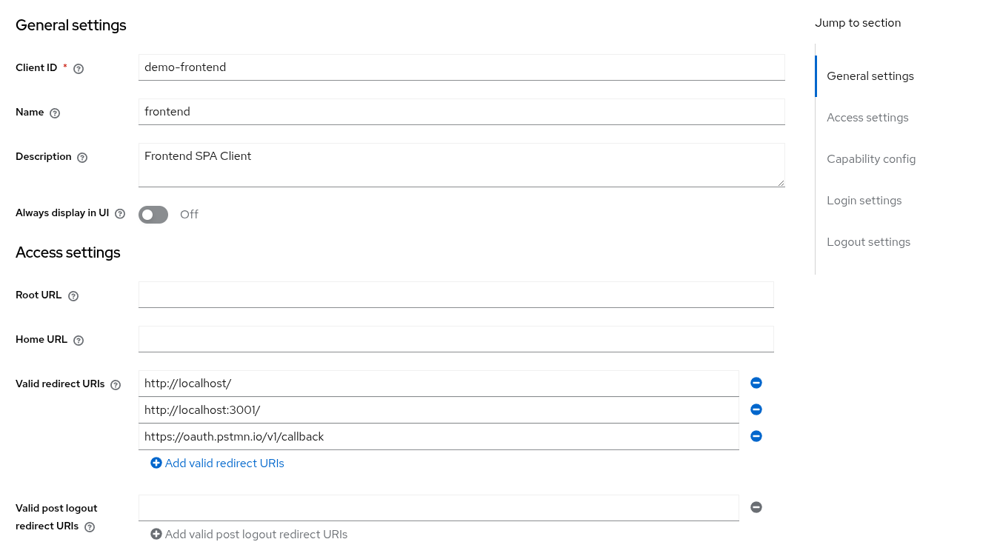
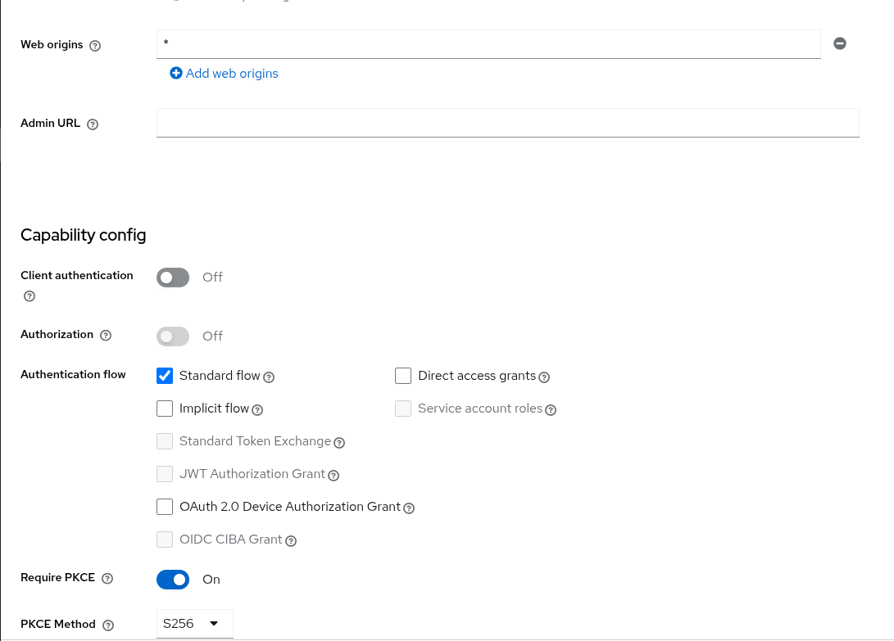

# VectorDB(Chroma)+Keycloak demo Application and OTEL
## Prerequisites
### Embeddings
Pulling embedding model to ollama container:
```shell
docker compose up -d ollama
docker compose exec -it ollama ollama pull embeddinggemma
docker compose down
```
### DataSet
To get movie dataset, use `tools/download_dataset.sh`,
you need to have python at least version>=3.9
```shell
cd tools
sh download_dataset.sh
```
### Keycloak
Create realm=demo and create User

Create client with PKCE, example:


## Start
```shell
docker compose up
``` 
After authorization, you can use service to show similar result:

```json
[
    {
        "metadata": {
            "overview": "Led by Woody, Andy's toys live happily in his room until Andy's birthday brings Buzz Lightyear onto the scene. Afraid of losing his place in Andy's heart, Woody plots against Buzz. But when circumstances separate Buzz and Woody from their owner, the duo eventually learns to put aside their differences.",
            "id": "862",
            "keywords": "jealousy, toy, boy, friendship, friends, rivalry, boy next door, new toy, toy comes to life",
            "title": "Toy Story",
            "distance": 0.4660271,
            "average score": "7.7"
        }
    },
    {
        "metadata": {
            "overview": "",
            "id": "59156",
            "keywords": "",
            "title": "Il giocattolo",
            "distance": 0.47678742,
            "average score": "7.0"
        }
    },
    {
        "metadata": {
            "overview": "During a post-Christmas play date, the gang find themselves in uncharted territory when the coolest set of action figures ever turn out to be dangerously delusional. It's all up to Trixie, the triceratops, if the gang hopes to return to Bonnie's room in this Toy Story That Time Forgot.",
            "id": "256835",
            "keywords": "toy, short, toy story",
            "title": "Toy Story That Time Forgot",
            "distance": 0.48083293,
            "average score": "6.8"
        }
    },
    {
        "metadata": {
            "overview": "The toys throw Ken and Barbie a Hawaiian vacation in Bonnie's room.",
            "id": "77887",
            "keywords": "short, toy story, pixar animation",
            "title": "Hawaiian Vacation",
            "distance": 0.4885955,
            "average score": "6.9"
        }
    },
    {
        "metadata": {
            "overview": "What starts out as a fun road trip for the Toy Story gang takes an unexpected turn for the worse when the trip detours to a roadside motel. After one of the toys goes missing, the others find themselves caught up in a mysterious sequence of events that must be solved before they all suffer the same fate in this Toy Story of Terror.",
            "id": "213121",
            "keywords": "halloween, toys, short",
            "title": "Toy Story of Terror!",
            "distance": 0.49172387,
            "average score": "7.3"
        }
    }
]
```
Result is pretty good, 3 toy stories + film with no overview that contains word toy in Italian and film with toy story keyword:
- [Toy Story](https://en.wikipedia.org/wiki/Toy_Story)
- [Il giocattolo](https://en.wikipedia.org/wiki/A_Dangerous_Toy)
- [Toy Story That Time Forgot](https://en.wikipedia.org/wiki/Toy_Story_That_Time_Forgot)
- [Hawaiian Vacation](https://en.wikipedia.org/wiki/Hawaiian_Vacation)
- [Toy Story of Terror!](https://en.wikipedia.org/wiki/Toy_Story_of_Terror!)

# Todo
- Add frontend for that